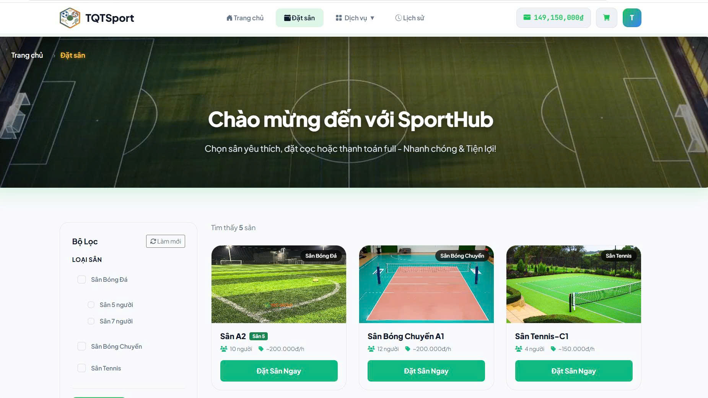
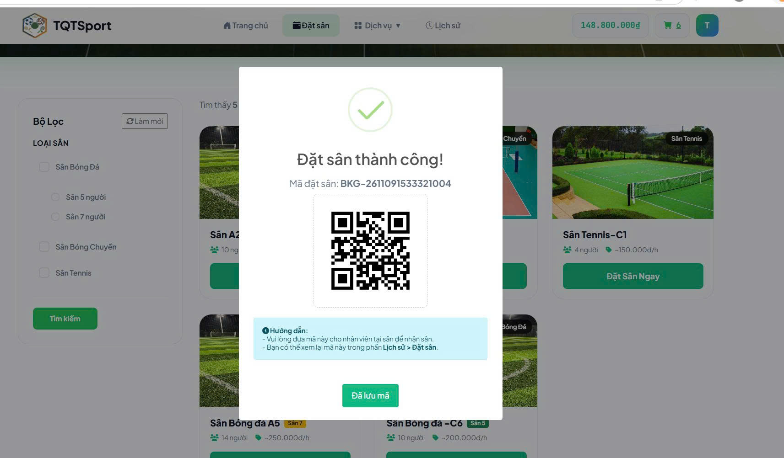
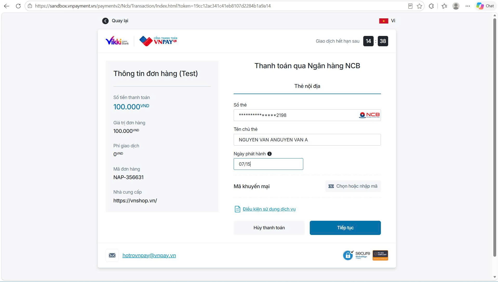
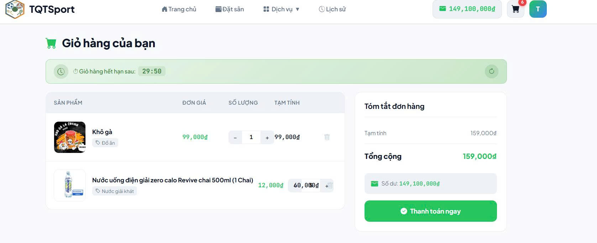
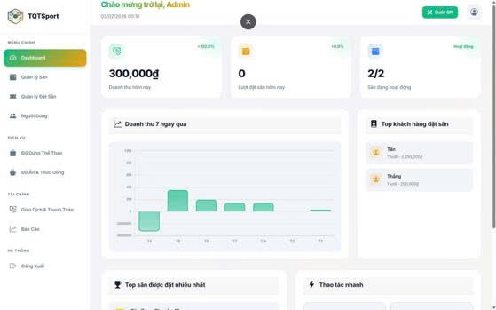
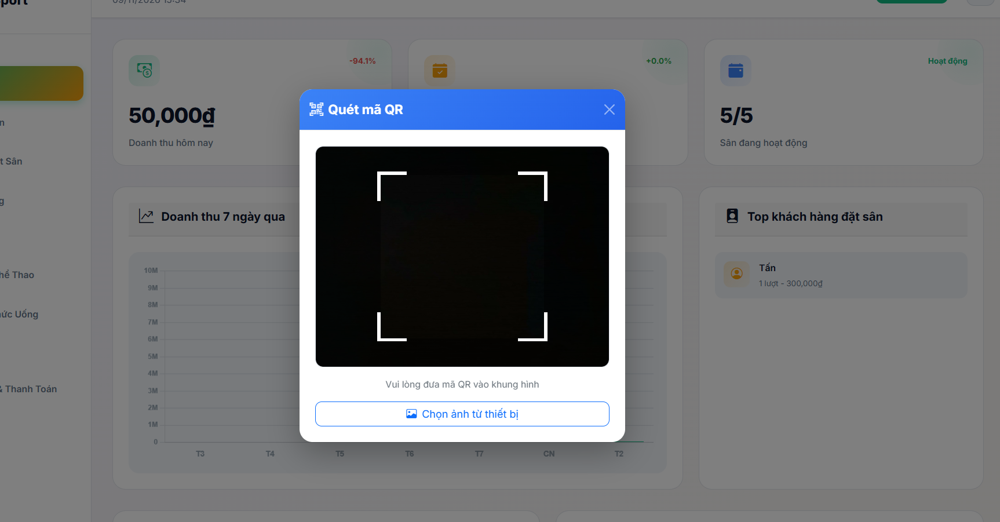
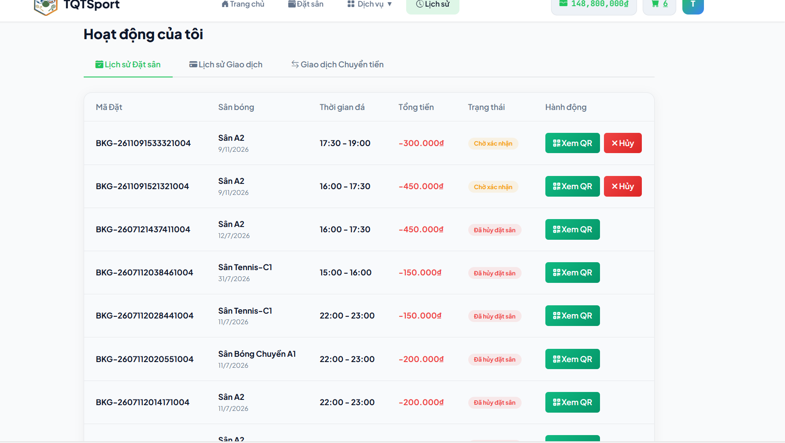

# ⚽ SportBookingSystem — Nền Tảng Quản Lý & Đặt Sân Thể Thao

[](https://dotnet.microsoft.com/)
[](https://www.microsoft.com/sql-server)
[](https://redis.io/)
[](https://www.rabbitmq.com/)
[](https://www.docker.com/)
[](https://aws.amazon.com/ec2/)

> **SportBookingSystem** là hệ sinh thái web toàn diện phục vụ việc tìm kiếm, đặt sân thể thao theo ca thời gian thực, quản lý giá linh hoạt, tích hợp thanh toán VNPay / Ví điện tử và bán kèm dịch vụ tiện ích (đồ ăn, nước uống, dụng cụ). Hệ thống được xây dựng trên nền tảng **ASP.NET Core 8**, áp dụng kiến trúc **N-Tier kết hợp Event-Driven Background Worker** và đã được đóng gói container triển khai thực tế trên **AWS EC2**.

---

## 📺 Video Demo & Hình Ảnh Dự Án

### 1. Video Demo Trải Nghiệm (Demo Walkthrough)
[](#)

---

### 2. Một Số Giao Diện Tiêu Biểu (Project Showcase)

#### 🏟️ Phân Hệ Khách Hàng (Customer Portal)

| 📅 Lịch Đặt Sân Theo Ca Thời Gian Thực | 🎟️ Vé Điện Tử & Mã QR Check-in |
| :---: | :---: |
|  |  |

| 💳 Nạp Tiền Cổng VNPay Sandbox | 🛒 Giỏ Hàng Canteen & Phụ Kiện |
| :---: | :---: |
|  |  |

#### ⚙️ Phân Hệ Quản Trị & Tác Vụ Nền (Admin & Worker)

| 📊 Admin Dashboard & Báo Cáo Doanh Thu | 📷 Camera Quét QR Check-in Tại Quầy |
| :---: | :---: |
|  |  |

| 📬 Email Vé Tự Động (RabbitMQ Worker) | 📜 Lịch Sử Đặt Sân & Hoạt Động |
| :---: | :---: |
|  |  |

---

## 🏗️ Kiến Trúc Hệ Thống (System Architecture)

```
                  +-----------------------------------------------+
                  |          Trình duyệt người dùng (Client)      |
                  +-----------------------------------------------+
                                          |
                                          | HTTPS / Port 80 (EC2)
                                          v
+----------------------------------------------------------------------------------+
|                           SportBooking Web App (.NET 8)                          |
|                                                                                  |
|  [GlobalExceptionMiddleware] -> [Controllers (Booking, Cart, Wallet, Admin)]    |
|                                                                                  |
|  - Hosted Services (Quét hủy đơn & hoàn tiền tự động)                            |
|  - Distributed Session (Giỏ hàng mua đồ)                                         |
+----------------------------------------------------------------------------------+
        |                          |                         |              |
        | EF Core                  | Fast Cache              | Publish      | Payment
        v                          v                         v              v
+----------------+       +-------------------+       +--------------+  +-----------+
|   SQL Server   |       |    Redis Cache    |       |   RabbitMQ   |  |   VNPay   |
|   (Database)   |       |  (Slot/Settings)  |       |   (Queue)    |  |  Gateway  |
+----------------+       +-------------------+       +--------------+  +-----------+
                                                            |
                                                            | Consume message
                                                            v
                                             +------------------------------+
                                             |   SportBookingEmailWorker    |
                                             |     (Background Worker)      |
                                             |                              |
                                             |   Tạo QR + Gửi vé qua SMTP   |
                                             +------------------------------+
```

---

## ✨ Tính Năng Nổi Bật

### 🏟️ Dành cho Khách Hàng (Customer)
- **Lịch đặt sân ma trận linh hoạt**: Lọc theo ngày, khung giờ (TimeSlots), sức chứa và loại sân. Tự động áp dụng giá theo giờ vàng hoặc giảm 25% nếu đặt trễ ca.
- **Thanh toán tích hợp**: Nạp tiền qua cổng VNPay hoặc sử dụng ví điện tử nội bộ. Bảo toàn dữ liệu tài chính bằng ACID Transactions.
- **Mua sắm tiện ích**: Giỏ hàng theo Session, mua sắm đồ uống và phụ kiện kèm theo ca thi đấu.
- **Vé QR Code**: Nhận email xác nhận kèm mã QR check-in tự động xử lý qua Message Queue.

### ⚙️ Dành cho Quản Trị Viên (Admin)
- **Dashboard trực quan**: Biểu đồ thống kê doanh thu, tổng số lượt booking theo ngày/tháng.
- **Quản lý sân bãi & Bảng giá**: Thêm/sửa sân, bảo trì sân, cấu hình đơn giá theo từng khung giờ đặc biệt.
- **Check-in nhanh**: Quét mã QR vé để xác nhận khách đến sân.
- **Quản lý kho & Người dùng**: Quản lý sản phẩm đồ uống/dụng cụ, phân quyền tài khoản và tra cứu dòng tiền giao dịch.

---

## 🛠️ Công Nghệ Sử Dụng (Tech Stack)

| Thành phần | Chi tiết công nghệ |
| :--- | :--- |
| **Backend** | .NET 8, ASP.NET Core MVC, C# |
| **Database & ORM** | SQL Server 2022, Entity Framework Core 8 |
| **Caching & Session** | Redis, Distributed Memory Cache, In-Memory Session |
| **Message Broker** | RabbitMQ (Topic/Direct Queue), .NET Worker Service |
| **DevOps & Cloud** | Docker, Docker Compose, AWS EC2, GitHub |
| **Bảo mật & Auth** | BCrypt.Net-Next, Cookie Authentication, Global Exception Middleware |
| **Tích hợp bên thứ 3**| VNPay Gateway, Cloudinary (Lưu ảnh), QRCoder, MailKit / SendGrid |

---

## 🚀 Hướng Dẫn Cài Đặt & Chạy Trên Local

### Yêu cầu tiên quyết:
- Đã cài [.NET 8.0 SDK](https://dotnet.microsoft.com/download/dotnet/8.0)
- Đã cài [Docker Desktop](https://www.docker.com/products/docker-desktop/)

### Các bước thực hiện:

1. **Clone mã nguồn về máy**:
   ```bash
   git clone https://github.com/TranMinhTan3110/SportBookingSystem.git
   cd SportBookingSystem
   ```

2. **Khởi động Database & Redis qua Docker**:
   ```bash
   docker compose up -d
   ```
   *(Container SQL Server sẽ chạy ở cổng `1435`, Redis chạy ở cổng `6379`)*

3. **Cấu hình Secret Keys**:
   Thiết lập connection string và cấu hình (hoặc tạo file `.env`):
   ```bash
   dotnet user-secrets set "ConnectionStrings:DefaultConnection" "Server=localhost,1435;Database=SportBookingDb;User Id=sa;Password=SportBooking3110!;TrustServerCertificate=True"
   ```

4. **Chạy ứng dụng Web**:
   ```bash
   dotnet run --launch-profile "http"
   ```
   👉 Truy cập web tại: **`http://localhost:5175`**

5. **(Tùy chọn) Chạy Robot gửi Email**:
   ```bash
   cd SportBookingEmailWorker
   dotnet run
   ```

---

## 🌐 Triển Khai Trên Production (AWS EC2)

Dự án đã chuẩn hóa cấu hình Production với `docker-compose.prod.yml`:
```bash
# Trên máy chủ AWS EC2
docker compose -f docker-compose.prod.yml pull
docker compose -f docker-compose.prod.yml up -d
```
Ứng dụng sẽ tự động áp dụng `db.Database.Migrate()` và mở cổng `80` cho người dùng truy cập trực tiếp qua Public IP của EC2.

---

## 👨‍💻 Tác Giả & Liên Hệ
- **Họ và tên**: Trần Minh Tân
- **Email**: tanbeo31102005@gmail.com
- **GitHub**: [@TranMinhTan3110](https://github.com/TranMinhTan3110)


